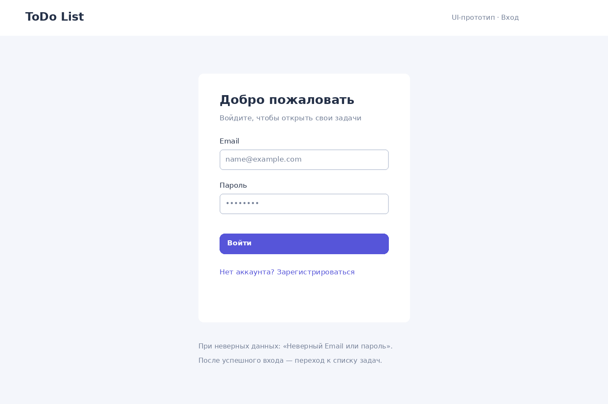
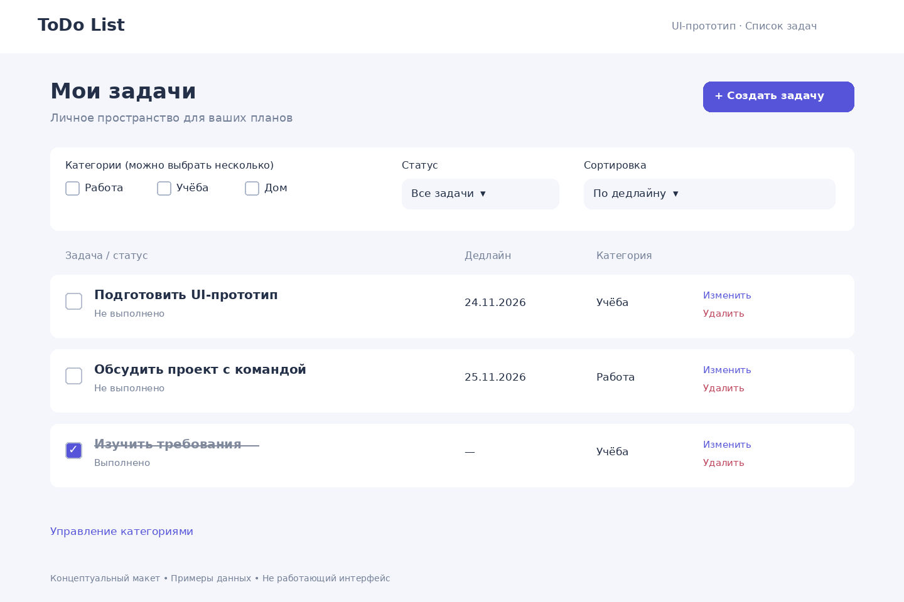
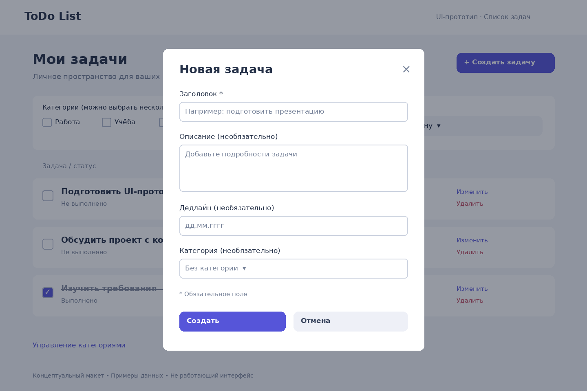

# UI-прототип ToDo List

## 1. Назначение

Документ описывает предлагаемый интерфейс веб-сервиса управления

личными задачами ToDo List.

Основание: [Требования к продукту](05_requirements.md).

Связанная задача: #11.

Макеты являются статическими изображениями для согласования интерфейса.

Они не подтверждают реализацию показанных функций.

Названия задач, категории и даты на изображениях — демонстрационные данные.

## 2. Состав прототипа

Подготовлены три макета:

1. Экран входа.

2. Главный экран со списком задач.

3. Модальное окно создания задачи.

Общий стиль: светлый фон, карточки с закруглёнными углами,

фиолетовый акцент для основных действий.

## 3. Экран входа

### Элементы интерфейса

- Поле Email.

- Поле «Пароль» со скрытием введённых символов.

- Кнопка «Войти».

- Ссылка «Зарегистрироваться».

### Сценарий входа

1. Пользователь открывает страницу /login.

2. Вводит Email и пароль.

3. Нажимает «Войти».

4. При успешной авторизации переходит на главную страницу /.

5. При неверных данных остаётся на странице входа

   и видит сообщение «Неверный Email или пароль».

На макете текст о результате входа приведён как пояснение.

В готовом интерфейсе сообщение об ошибке должно появляться

после неудачной попытки входа.

Ссылка «Зарегистрироваться» предназначена для перехода к форме

регистрации. Отдельный макет регистрации в данный документ не входит.

Связанные требования: US-01, US-02, US-10.

## 4. Главный экран со списком задач

### Элементы интерфейса

- Заголовок «Мои задачи».

- Кнопка «Создать задачу».

- Фильтры по категориям с возможностью выбрать несколько категорий.

- Фильтр по статусу: все, выполненные, невыполненные.

- Выбор сортировки: по дедлайну или по алфавиту.

- Список задач.

- Действия «Изменить» и «Удалить» для каждой задачи.

- Ссылка «Управление категориями».

Для каждой задачи отображаются:

- заголовок;

- статус «Выполнено» или «Не выполнено»;

- дедлайн;

- категория.

Выполненная задача отмечается установленным флажком

и зачёркнутым заголовком.

### Просмотр задач

1. После успешного входа пользователь открывает главную страницу.

2. Видит только собственные задачи.

3. Если пользователь не авторизован, происходит переход на страницу входа.

### Фильтрация и сортировка

1. Пользователь выбирает одну или несколько категорий.

2. При необходимости выбирает статус задач.

3. Список обновляется с учётом выбранных фильтров.

4. Пользователь выбирает сортировку по дедлайну или по алфавиту.

5. Порядок задач изменяется согласно выбранному варианту.

### Изменение статуса

1. Пользователь нажимает флажок рядом с задачей.

2. Статус переключается между выполненным и невыполненным.

3. Внешний вид задачи обновляется.

### Редактирование

1. Пользователь нажимает «Изменить» рядом с задачей.

2. Открывается форма с текущими значениями полей.

3. Пользователь меняет заголовок, описание, дедлайн или категорию.

4. Сохраняет изменения.

5. Обновлённые данные отображаются в списке.

Предлагается использовать для редактирования окно,

аналогичное окну создания, с заполненными полями

и кнопкой «Сохранить».

### Удаление

1. Пользователь нажимает «Удалить».

2. Открывается окно подтверждения.

3. При подтверждении задача удаляется и исчезает из списка.

4. При отмене задача остаётся без изменений.

### Управление категориями

Ссылка «Управление категориями» предназначена для открытия

интерфейса создания и удаления категорий.

Согласно требованиям, имя категории должно быть уникальным.

При удалении категории связанные задачи сохраняются без категории.

Отдельные макеты редактирования, подтверждения удаления

и управления категориями в данный документ не входят.

Связанные требования: US-04–US-10.

## 5. Модальное окно создания задачи

### Элементы интерфейса

- Поле «Заголовок» — обязательное.

- Поле «Описание» — необязательное.

- Поле «Дедлайн» — необязательное.

- Поле «Категория» — необязательное.

- Кнопка «Создать».

- Кнопка «Отмена».

- Кнопка закрытия в правом верхнем углу.

### Создание задачи

1. На главной странице пользователь нажимает «Создать задачу».

2. Поверх списка открывается модальное окно.

3. Пользователь вводит заголовок.

4. При необходимости добавляет описание, дедлайн и категорию.

5. Нажимает «Создать».

6. После успешного сохранения окно закрывается.

7. Новая задача появляется в общем списке собственных задач

   с учётом действующих фильтров.

Если заголовок не заполнен, задача не создаётся.

Предлагаемое сообщение рядом с полем:

«Введите заголовок задачи».

### Отмена создания

1. Пользователь нажимает «Отмена» или кнопку закрытия.

2. Окно закрывается.

3. Новая задача не создаётся.

Связанное требование: US-03.

## 6. Дополнительные состояния для реализации

Следующие состояния описаны текстом и не представлены

отдельными изображениями:

- Пустой список: сообщение «У вас пока нет задач»

  и кнопка создания задачи.

- Нет результатов фильтрации:

  сообщение «По выбранным фильтрам задач нет».

- Загрузка: индикатор получения или сохранения данных.

- Ошибка сохранения: сообщение об ошибке;

  введённые данные остаются в форме для повторной попытки.

- Ошибка входа: сообщение о неверных учётных данных.

Формулировки сообщений и визуальные детали этих состояний

предлагаются для согласования с командой.

## 7. Границы работы

В рамках задачи подготовлены статические макеты

и описания основных пользовательских сценариев.

Реализация компонентов React, взаимодействия с API,

авторизации и автоматических тестов в эту работу не входит.
